# 📝 Практична робота №7 - MS SQL | Варіант 14

## Мета роботи
Навчиться створювати, змінювати та видаляти таблиці в БД, заносити, оновлювати та видаляти інформацію з цих таблиць. Навчиться створювати найпростіші запити до бази даних.

## Предметна область
#### Автосервіс
Підприємство ремонтує автомобілі. Для автомобілів відомий набір операцій з ремонту, вартість кожної операції та тривалість ремонту за наявності на складі всіх необхідних для цієї операції деталей. Деякі запчастини на даний момент можуть бути відсутніми на складі або перебувати в недостатній кількості. Певні деталі постачаються партіями відомого обсягу з відомим терміном поставки. Ремонтні операції виконуються майстрами. Майстер приступає до нового ремонту на наступний день після завершення попередньої ремонтної операції і одночасно два ремонти не виконує.

----

#### Логічна модель:
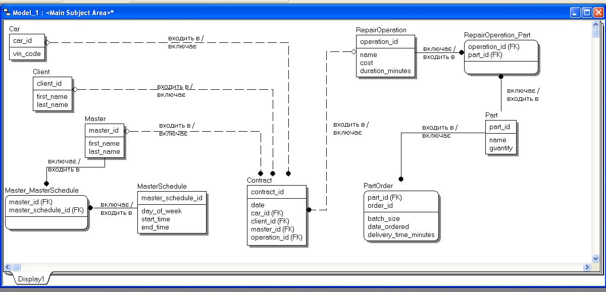

#### Фізична модель:
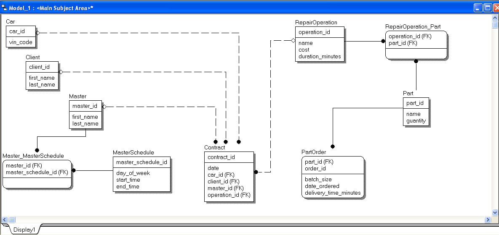

## 📋 Завдання №3
До свого варіанта (основного, по якому були виконані практичні роботи 3, 4, 5 та 6) додати бізнес-правила. Приклад створення бізнес правил у додатку А.

### Відповідь ###
1. Для виконання ремонтної операції повинні бути на складі всі необхідні запчастини в достатній кількості, а також мати вільного майстра. Якщо якихось запчастин немає або всі майстри зайняті, ремонт не може бути розпочатий.

2. Запчастини, які відсутні на складі, постачаються партіями з визначеним обсягом та терміном постачання.

3. Для кожної ремонтної операції має бути вказано, який майстер її буде виконувати. Один майстер не може одночасно виконувати кілька ремонтів.

4. Кількість майстрів у автосервісі обмежена. Якщо всі майстри зайняті, новий ремонт не може бути розпочатий до завершення поточного ремонту.

5. У кожному контракті на ремонт повинні бути вказані наступні дані: майстер, який виконував ремонт, клієнт, який замовив ремонт, автомобіль, над яким був виконаний ремонт, назва ремонтної операції та дата підписання контракту. Ці дані мають бути зафіксовані для кожного ремонту з метою забезпечення точного обліку та контролю за виконаними роботами.

## 📋 Завдання №4
Для кожної сутності зробити опис у вигляді таблиці з вказанням: імені атрибута, фізичного імені, типу даних T-SQL, PKEY, FKEY, ALLOW NULLS, UNIQUE. Приклад створення у додатку А.

### Відповідь ###
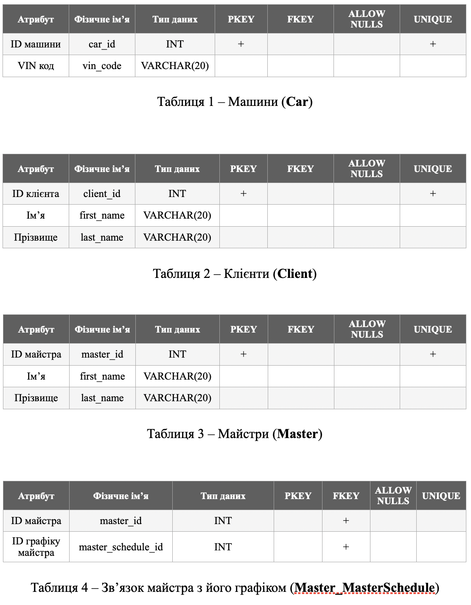
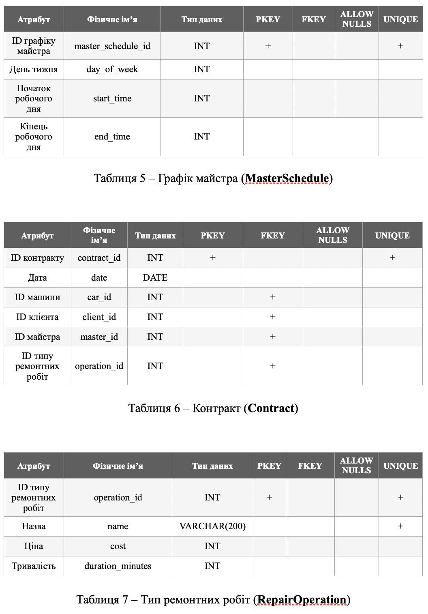
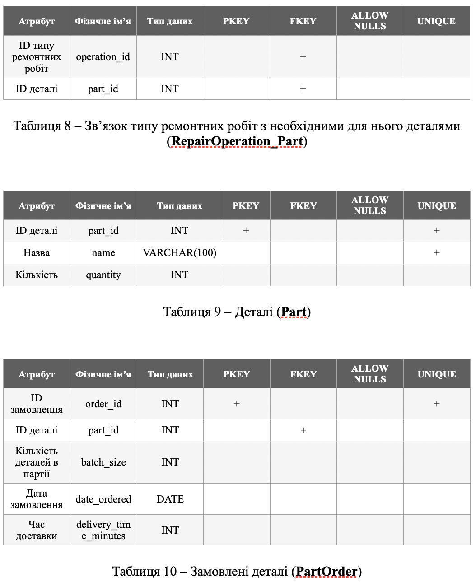

## 📋 Завдання №5
Використовуючи мову T-SQL зробити скрипти (приклад створення у додатку А):
- Створення таблиць та змінення структури таблиць БД – SETUP.SQL;
- Занесення інформації в таблиці БД – INSERT.SQL.
- Зміни/оновлення/видалення інформації у таблицях БД – UPDATE.SQL;
- Очищення та видалення всіх таблиць – DELETE.SQL.

### Відповідь ###
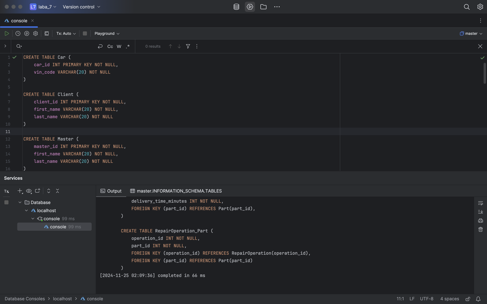
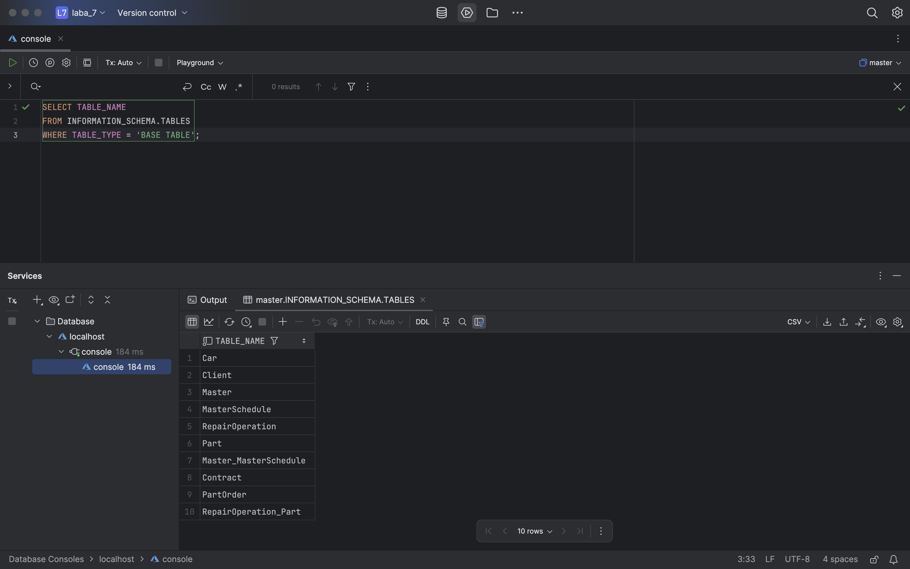
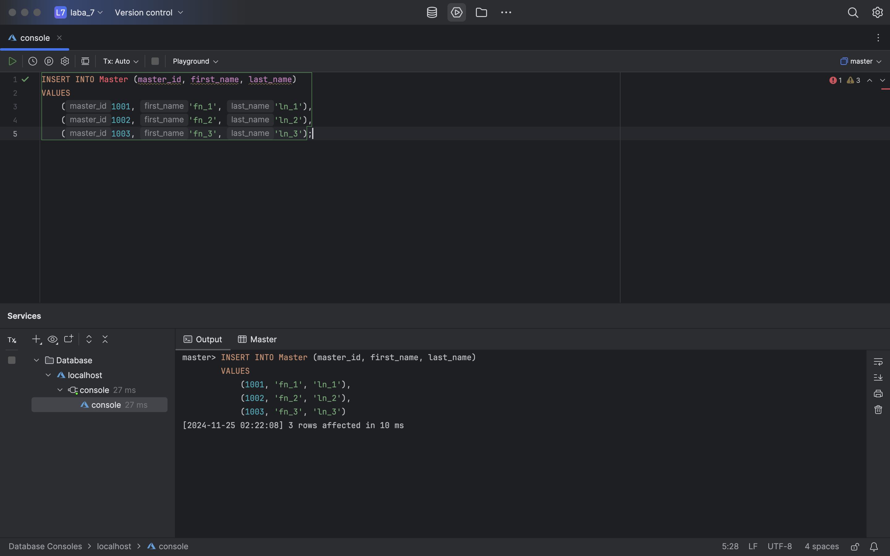
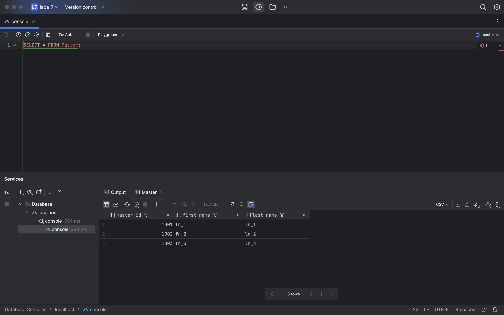
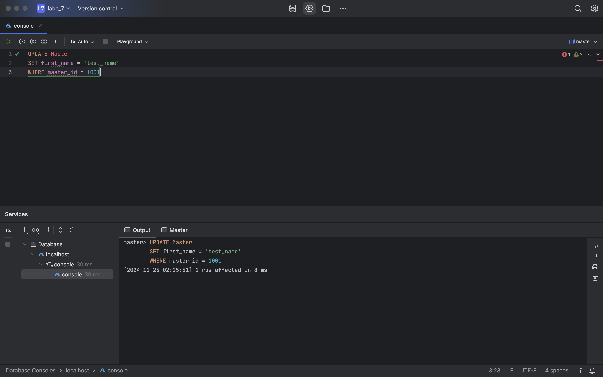
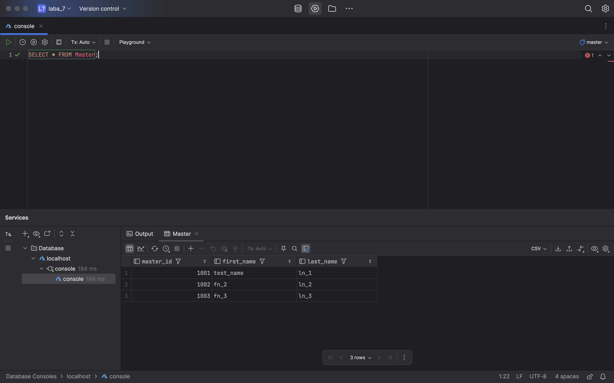
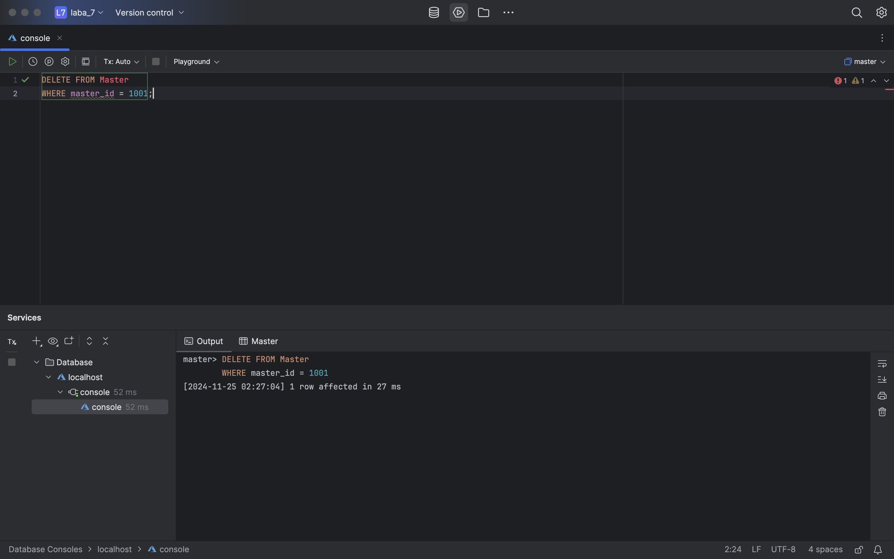
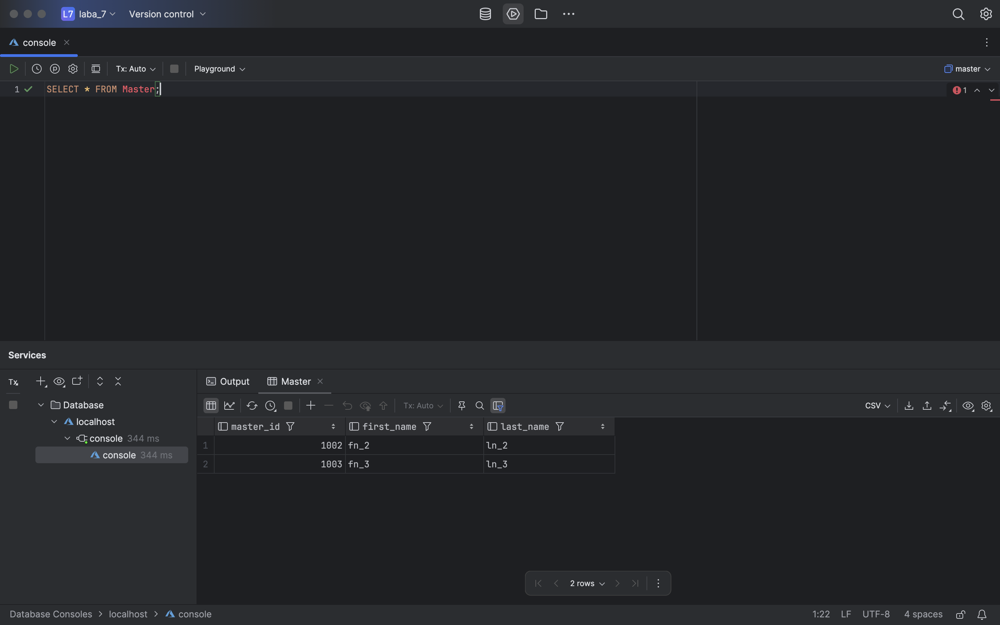
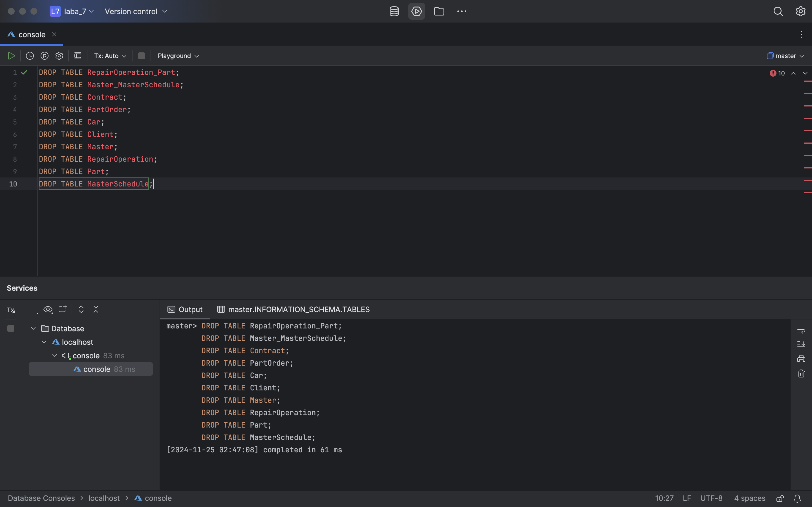

## 💭 Висновки
У процесі виконання роботи було вивчено основні принципи роботи з реляційними базами даних, зокрема створення, зміна та видалення таблиць, а також маніпулювання даними в них. Оволоділи навичками створення таблиць із визначенням відповідних типів даних, первинних та зовнішніх ключів. Навчилися виконувати операції додавання, оновлення та видалення записів у таблицях через SQL-запити. Ці навички є основою для подальшого розвитку в роботі з базами даних та управлінні даними в інформаційних системах.